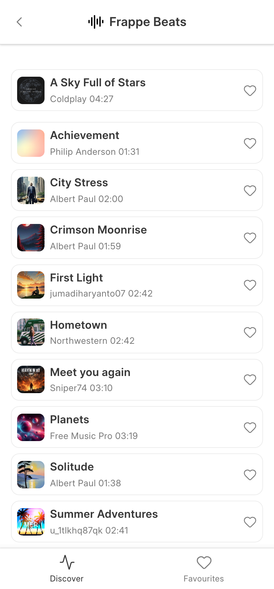
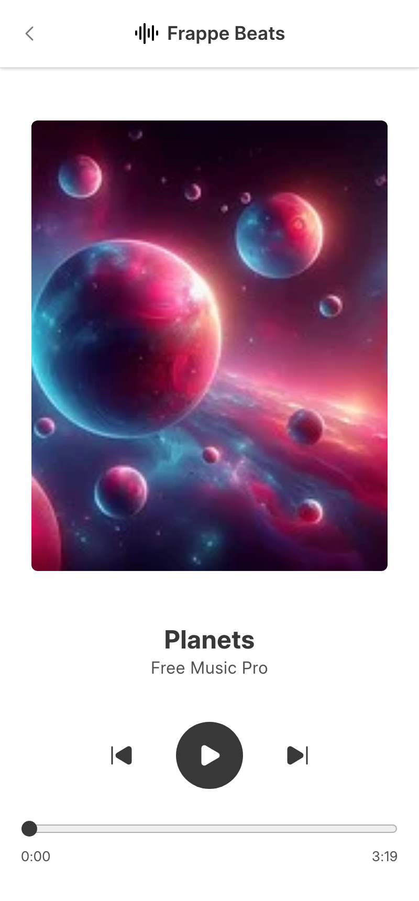
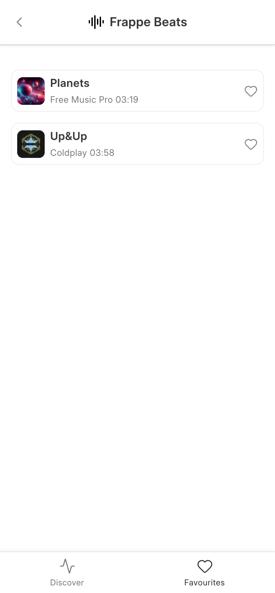
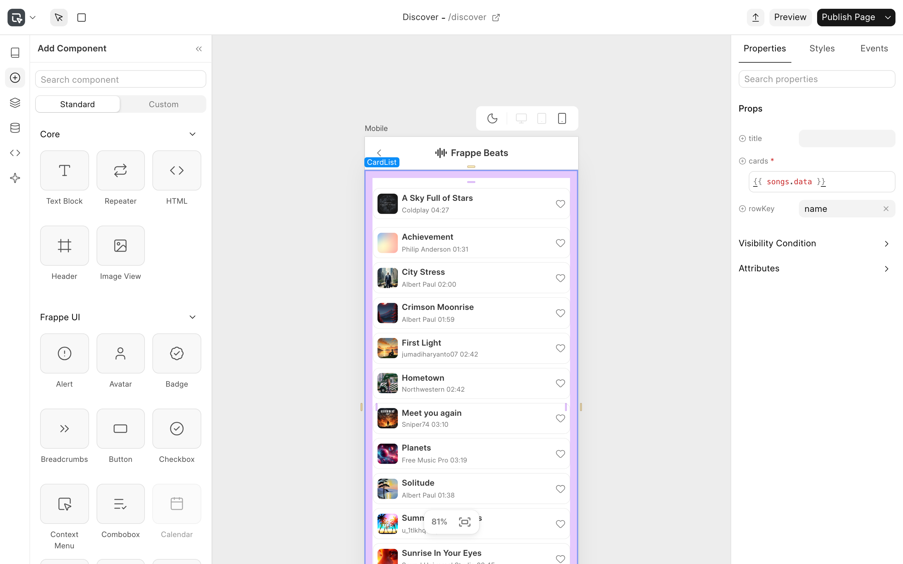

# Music

A mobile music player built with [Frappe Studio](https://github.com/frappe/studio).

The app ships one Studio app, **Beats**. You can browse songs, play them and keep a list of the songs you like.

<table>
  <tr>
    <td></td>
    <td></td>
    <td></td>
  </tr>
  <tr>
    <td align="center">Discover</td>
    <td align="center">Song</td>
    <td align="center">Favourites</td>
  </tr>
</table>

## Pages

| Page | Route | What it does |
|---|---|---|
| Discover | `/beats/discover` | Lists all songs. Tap a song to open it. |
| Song | `/beats/song/:name` | Shows the cover, title and artist, plays the track, and lets you like the song. |
| Favourites | `/beats/favourites` | Lists the songs you liked. |

## Built with Frappe Studio

The pages are built in the Studio editor. They are exported to [`studio/beats`](studio/beats) as JSON, so you can open and change them in Studio.



The app has these parts:

- **Doctypes:** `Song`, `Playlist` and `Playlist Song`. `Song` has a whitelisted `like_song` method that the Song page calls.
- **Pages:** [`studio/beats/studio_page`](studio/beats/studio_page). Each page reads `Song` records through a data source.
- **Custom Vue components:** [`studio/beats/components`](studio/beats/components) has `AppHeader`, `Audio`, `BottomTabs`, `CardList` and `AvatarCard`. Studio picks them up from this folder and shows them under **Custom** in the component panel.

## Installation

This app needs [Frappe Studio](https://github.com/frappe/studio). `bench get-app` installs it for you because it is listed in `required_apps`.

```bash
cd $PATH_TO_YOUR_BENCH
bench get-app https://github.com/ruchamahabal/music --branch develop
bench --site $SITE install-app music
bench build --app music
```

`bench build --app music` also builds the Beats bundle. Then open `http://$SITE/beats`.

The app does not ship sample data. Add a few `Song` records in the desk at `/app/song`, with a cover image and a music file, to see the pages filled in.

## Contributing

This app uses `pre-commit` for code formatting and linting. [Install pre-commit](https://pre-commit.com/#installation) and enable it for this repository:

```bash
cd apps/music
pre-commit install
```

Pre-commit runs ruff, eslint, prettier and pyupgrade.

## License

MIT
